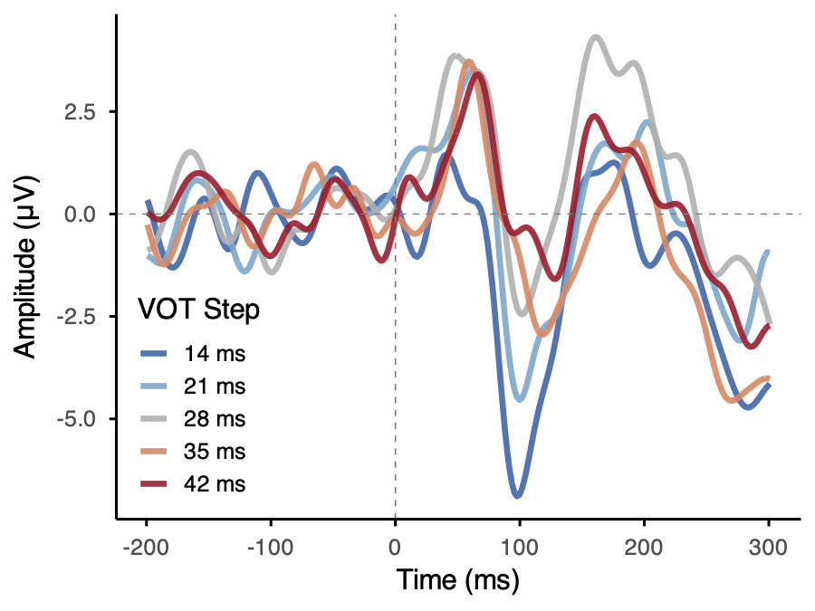

# What does this script do?
This script performs automated EEG preprocessing for single-trial ERP analyses. The dataset for which this script was designed contained eventcodes already, so there is no insertEventcodes step. If you have a dataset without eventcodes, make sure to insert them before running this script.

# Order of operations 

In order, the analysis is the following:

1) Set important variables
    - EVENTID = conversion of BioSemi eventcodes to more human-readable codes.
    - STIM-DELAY = 50 ms of silence prior to each stimulus onset, plus ~1 ms to account for the delay in the sound travelling from the Etymotic ER-3A earbud speakers through tubes to the subject's ears.
    - L_freq, H_freq = bandpass filter frequencies that are optimal for auditory ERP research. See https://doi.org/10.1111/psyp.12437Digital for optimal filtering suggestions.
2) Read in the data, downsample to 512 Hz.
    - BioSemi systems record at very high sampling rates. This makes very large files that are slow to process. We will downsample to 512 Hz, because that is well above the Nyquist frequency for capturing 30 Hz ERPs. 
3) Remove unused channels (the recording montage only used the first two EXG channels, so we'll drop the rest).
4) Re-reference the continuous signal to your choice of offline reference (I prefer linked mastoids).
5) Bandpass filter the EEG signal, removing slow sweat artifacts along with high-frequency artifacts.
6) Add channel locations 
    - Always a good step in case someone would like to do source localization in the future
7) Epoch data, converting the long continuous signal into chunks that begin 200 before stimulus onset and end 
300 ms post-onset. Adjust the second time bound if you're investigating ERPs at a different latency. 
8) Artifact Rejection - reject trials that are contaminated by blinks and/or muscle movements.
9) Output average EEG amplitude on each trial over the chosen latency.
10) Create averaged ERPs, collapsing across trials, and output a test figure for quality control.

# End product
After following this procedure, your ERPs should look resemble the following image (note: mne.viz.plot 
figures look different, but the general shape should be the same, if you are looking at N100 data).

